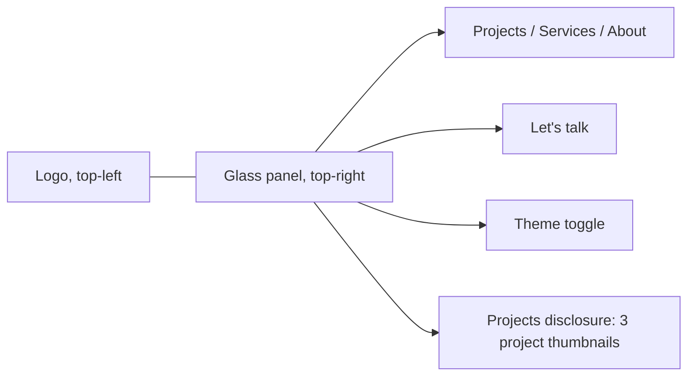

# Duncan Tima portfolio build

## What I found

- `/Users/jojovera/Documents/duncan_website` is empty (only `.cursor/settings.json`), so this is a fresh scaffold. I'll use pnpm because it's installed, along with Node 22.
- There are two logo variants, both 875x649 transparent PNGs:
  - `logo_main_black`: a solid black pixel "D.T", used in the light theme.
  - `logo_main_white`: white fill with a black pixel outline and drop shadow. On near-black the white fill carries the mark, so this one is used in the dark theme.
  - Both will be copied to `public/brand/` with descriptive names. Transparent padding may be trimmed, but the aspect ratio stays locked.
- `duncantima.framer.website` returns 401, so it's password-protected. You chose to type the password yourself in Cursor's browser while I capture the content. The password never goes into code, docs, or env files.
- The services screenshot hasn't arrived yet; only the Vucko reference came through. You'll attach it, and it will be the authority for `src/content/services.ts`.

## Visual system

- **Type:** Geist Sans for display and body, and Geist Mono for small metadata labels (client, role, date, row numbers). The mono echoes the pixel logo without imitating it. Both load through `next/font`, and the type scale is fluid with `clamp()`.
- **Color:**
  - Dark theme (the default): near-black `#0B0B0C` with stepped neutral surfaces (`#121214`, `#1A1A1D`), white text, and two muted grays.
  - Light theme: off-white `#F4F3F0` with matching stepped surfaces and near-black text.
  - Borders are hairlines (`1px`, low-alpha foreground). The interface stays monochrome, and project imagery keeps its original color.
- **Glass:** `backdrop-blur` plus a translucent surface, used only on the nav panel and the mobile menu. An `@supports not (backdrop-filter)` rule and `prefers-reduced-transparency` both fall back to an opaque surface.
- **Tokens:** CSS variables in `src/app/globals.css`, mapped through Tailwind v4 `@theme`. They cover color, spacing, type, radii, borders, shadow, and motion (durations and easings). A matching `src/lib/motion.ts` holds the Framer Motion presets.

## Signature navigation



- **Wide screens:**
  - The logo sits on the left. A floating glass panel on the upper right holds the links, a filled "Let's talk" button, and the theme toggle.
  - The active indicator is a shared `layoutId` pill that slides between links.
  - After about 40px of scroll, the panel compresses: less padding, a more opaque surface, and the logo scales down.
- **Link between navigation and the work:** "Projects" stays a real link to `/projects`. A small adjacent disclosure button, keyboard-operable with `aria-expanded`, opens a panel showing the three project thumbnails with their names. On a case-study page, the panel shows which project you're on and which is next. None of this is essential, hover-only content, because every project is also linked on the pages themselves.
- **Mobile:**
  - A compact header holds the logo and a Menu button.
  - The menu is a full-height glass sheet: large numbered links, project thumbnails, the "Let's talk" action, the theme toggle, and contact details.
  - Behavior: focus trap, Escape and a visible close button both dismiss it, focus returns to the trigger, scroll is locked, and touch targets are at least 44px.
- Content offset uses a `--nav-offset` token on `main` plus `scroll-margin-top` on headings and anchors, so the fixed navigation never covers content.

## Theme

- `next-themes` with `attribute="class"`, `defaultTheme="dark"`, `enableSystem={false}`, and `disableTransitionOnChange`. It saves the choice to localStorage and applies it with an inline script before paint.
- In Tailwind v4: `@custom-variant dark (&:where(.dark, .dark *));`.
- `suppressHydrationWarning` on `<html>`. The toggle mounts safely (no theme-dependent markup before hydration), has an `aria-label` naming the theme it switches to, and uses `aria-pressed`.
- Logo swap: both images render and CSS shows one based on `.dark`, so there's no hydration mismatch.

## Architecture

```
src/
  app/
    layout.tsx, page.tsx, not-found.tsx, sitemap.ts, robots.ts, opengraph-image.tsx
    projects/page.tsx, projects/[slug]/page.tsx (generateStaticParams)
    services/page.tsx, about/page.tsx, contact/page.tsx, contact/actions.ts
  components/
    layout/      SiteHeader, Footer, SkipLink, ClosingCta, Container
    navigation/  NavPanel (client), MobileMenu (client), ThemeToggle (client), ProjectsDisclosure (client)
    projects/    ProjectFeature, ProjectIndexRow, ProjectMeta
    case-study/  BlockRenderer, TextBlock, ImageBlock, ImagePairBlock, QuoteBlock, MetricsBlock, SectionHeading, SectionIndex (client), NextProject
    home/        Hero (client, staged entrance), HeroWorkStack (GSAP scroll sequence), SelectedWork, ServicesIntro, AboutIntro, Testimonials
    contact/     InquiryForm (client)
    ui/          Button, Reveal (client), GlassSurface, Tag
  content/
    types.ts                         Project, CaseStudyBlock union, Service, Testimonial, Experience
    projects/proof.ts, proofops.ts, userwise.ts, index.ts
    services.ts, about.ts, testimonials.ts
  lib/
    content.ts                       getProjects(), getProject(slug), getNextProject(slug), getServices(), getAbout(), getTestimonials()
    site-config.ts                   name, email, phone, LinkedIn, siteUrl, bookingUrl from env
    inquiry/                         schema.ts (zod), deliver.ts (provider interface), providers/resend.ts
    motion.ts, seo.ts                (JSON-LD helpers)
public/brand/, public/images/projects/{proof,proofops,userwise}/, public/images/about/
```

- All pages are Server Components. Client islands are limited to the navigation, theme toggle, hero entrance, `Reveal`, the section index, the GSAP sequence, and the form.
- `src/lib/content.ts` functions are `async` and return typed data. A later Sanity integration only replaces their bodies.
- Case-study blocks form a discriminated union: `text | image | imagePair | quote | metrics | sectionHeading`, with a `variant` field for layout. Each image carries `width`, `height`, `alt`, and `fit: "contain" | "cover"`.
- `next.config.ts` adds permanent redirects from `/proof`, `/proofops`, and `/userwise` to `/projects/*`.

## Pages

- **Home:**
  - Spacious opening: the name, the headline "Complex products. Clear experiences.", and a short first-person introduction based on Duncan's positioning statement.
  - A layered arrangement of real screenshots from all three projects, which separates slightly on scroll through a GSAP ScrollTrigger scrub. No pinning or scroll hijacking.
  - Links to view projects and start an inquiry.
  - Selected work at varied scales: one full-width feature and a 7/5 asymmetric pair, with metadata always visible.
  - A typographic services introduction, a short personal introduction with a photo, the two verified testimonials, a closing invitation, and the footer.
- **Projects:** a large image-led list with alternating composition. Each entry has its number, name, summary, role, category, and year, and the whole entry is a link. There are no filters.
- **Case studies:**
  - Header with the title, summary, and a client / role / service / date grid, followed by a large lead image.
  - Narrative blocks, then a sticky section index on screens 1280px and wider (an IntersectionObserver highlights the current section).
  - Next-project navigation and a closing inquiry action.
  - For Proof, a "Baseline" metrics block and a separate "Source-reported outcomes" block, labeled clearly, with no invented methodology.
  - ProofOPS has no numerical outcomes. Its routing logic (teams, roles, routing) gets a simple diagram.
  - Userwise frames the 2023 launch and the Halfbrick (Fruit Ninja) mention in the past tense, attributed to the source.
- **Services:** numbered typographic rows with selective examples, driven by `services.ts` and sourced from your screenshot. No prices or deliverables beyond what the source shows.
- **About:** the photo, the personal detail about coffee runs, sports events, and mentorship, and the experience timeline (role, company, years). No position is marked as current.
- **Contact:**
  - Inquiry form fields: name, email, optional company, project type, project description, optional budget, optional timeline.
  - A discovery-call card, plus email, phone, and LinkedIn.
- **Not found:** a short message with links to the projects and the home page.

## Contact delivery

- A Server Action (`useActionState`) validates input with zod on the server. Field errors are tied to inputs with `aria-describedby`, the form has a pending state and a honeypot, and a status region announces results.
- `deliverInquiry()` picks a provider from environment variables. The Resend REST API is the first provider, using `RESEND_API_KEY`, `CONTACT_TO_EMAIL`, and `CONTACT_FROM_EMAIL`, called with plain `fetch` and no SDK.
- If no provider is configured, or delivery fails, the form returns a non-success state with a prefilled `mailto:` fallback. It never reports success unless the provider accepted the message.
- `NEXT_PUBLIC_BOOKING_URL` is optional. When it isn't set, the button reads "Request a discovery call by email" and opens a prefilled mailto.
- `.env.example` lists names only: `NEXT_PUBLIC_SITE_URL`, `NEXT_PUBLIC_BOOKING_URL`, `RESEND_API_KEY`, `CONTACT_TO_EMAIL`, `CONTACT_FROM_EMAIL`.

## Motion

- **Framer Motion:**
  - Staged hero entrance (about 600ms in total).
  - The `layoutId` nav indicator and the panel compression.
  - The menu sheet.
  - `Reveal` for image clip/opacity reveals.
  - Small hover scale on project images.
- **GSAP** is used only for `HeroWorkStack`. It runs through `useGSAP`, scoped to its container, and animates wrapper elements Framer doesn't touch. Cleanup is automatic, and it's disabled under `gsap.matchMedia` for reduced motion and screens narrower than 768px.
- `MotionConfig reducedMotion="user"`. All content is visible and in its final layout without JavaScript or animation.
- **Aceternity UI:** I'll copy in at most one or two components, restyled to these tokens, and only where they fit, for example as the basis of the hero image stack. No glow or spotlight effects.

## SEO and accessibility

- `generateMetadata` on each page, a default Open Graph image built with `next/og` in monochrome with the logo, and `sitemap.ts` / `robots.ts` built from `NEXT_PUBLIC_SITE_URL`.
- JSON-LD: `Person` (name, job title, email, LinkedIn `sameAs`) and `CreativeWork` for each case study (name, description, dateCreated, author). No review schema.
- Landmarks, a skip link, a single h1 per page, visible `:focus-visible` rings, AA contrast checked for muted gray in both themes, `next/image` with explicit `sizes`, `priority` only on the hero and lead images, and no horizontal overflow.

## Asset capture (during implementation)

1. Open the Framer site with `cursor-ide-browser` and ask you to enter the password. I'll stop and wait until you have.
2. On each page (home, proof, proofops, userwise, services, about), record the text structure and the image order, and pull image URLs and natural dimensions with `Runtime.evaluate`.
3. Download the images with `curl` into `public/images/...` using descriptive names (for example `proof-job-tracker-health-indicators.png`), and copy the testimonials word for word.
4. Write `docs/asset-inventory.md` listing each file, its source page, dimensions, where it's used, and its fit mode. Anything I can't capture gets a labeled neutral placeholder ("Image pending: ...") and goes on a missing-assets list.

## Verification

- Run `pnpm lint`, `tsc --noEmit`, and `pnpm build`.
- In the browser, at desktop and mobile widths and in both themes, check every route, the nav (keyboard, Escape, focus return), theme persistence across reloads with no flash, form states (validation errors, pending, unconfigured fallback, success with a mocked provider), reduced motion, the redirects, and the 404 page.
- Grep for secrets.
- Finish with `README.md` (setup, env vars, content editing, enabling delivery, the Sanity path) and the list of missing assets and configuration.
